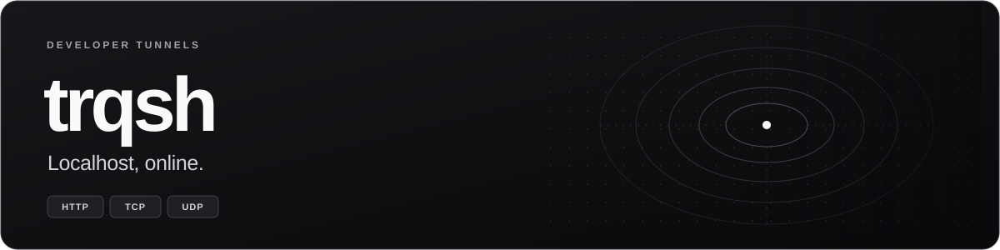

# trqsh · Website & documentation

**The public product experience: discover, download and learn.**

The public face of trqsh: landing, pricing, download, and the full documentation
(including a generated API reference). **Next.js 15** (App Router) + **TypeScript** +
**Tailwind**, with a hand-written shadcn-style UI kit. Lives at
**[trqsh.uz](https://trqsh.uz)**.

Part of the [trqsh monorepo](../../README.md) — the backend it links to lives in
[`cmd/`](../../cmd) / [`internal/`](../../internal). Marketing and documentation
share a monochrome design system in `app/globals.css`.

[Quick start](#quick-start) · [Design](#design-and-navigation) · [Generated content](#generated-content) · [Documentation](#documentation-editing) · [Configuration](#configuration) · [Deployment](#deployment)

| Package | Stack | Development URL |
| --- | --- | --- |
| `trqsh-site` · private | Next.js 15 · React 19 · TypeScript · Tailwind | `http://localhost:3002` |

## Design and navigation

The site has white and black themes, a static wordmark, and neutral borders.
The header's theme button is available on desktop and mobile. Explicit choices
persist in local storage; otherwise the site follows the system color scheme.
A small head script applies the theme before paint, and other open tabs sync
when the saved preference changes. Primary actions adapt to each palette, while
terminal examples and promotional panels retain a readable dark palette.
The landing page opens with a monochrome dotted WebGL tunnel. Three.js loads
after hydration; the scene uses a capped drawing-buffer size and frame rate,
and stops when the hero is offscreen or the tab is hidden. The hero follows the
active theme: dark dots on white in light mode, and light dots on black in dark
mode. Text, buttons, and the readability gradient share the selected palette.
The hero keeps a plain theme background until the scene is ready, with no cards
over the tunnel. That background also remains when WebGL is unavailable or
reduced motion is enabled.
The interactive HTTP/TCP/UDP command example has a moving protocol selector,
typed commands, and an animated connection diagram. Sample output is labeled.
Headlines enter word by word, content reveals once on scroll, and cards and
buttons have hover feedback. The sticky navigation includes reading progress.
All motion respects the visitor's reduced-motion preference, and content stays
readable without JavaScript. Pricing and download share the same interactions.
Mobile menus support Escape and close after navigation; all pages have a skip link.

Pricing amounts and limits come from the generated catalog, including annual
billing. Paid plans open the existing Telegram upgrade flow. Downloads allow
explicit platform and architecture selection, falling back to a matching CLI
archive when a desktop build is unavailable. CLI and desktop versions are shown
separately. The docs sidebar filters guides locally with an empty state.

## Quick start

Run from the repository root, with Node.js and pnpm installed:

```bash
cd web/site
pnpm install --frozen-lockfile
pnpm dev        # http://localhost:3002
pnpm build      # production build
pnpm typecheck
```

Runs on **:3002** so it can coexist with the dashboard (:3000) locally.

| Command | Result |
| --- | --- |
| `pnpm dev` | Development server on port 3002. |
| `pnpm typecheck` | TypeScript validation. |
| `pnpm build` | Production build using checked-in content snapshots. |
| `pnpm start` | Serve the production build on port 3002. |
| `pnpm gen:plans` | Refresh the public plan catalog from the configured API. |
| `pnpm gen:openapi` | Refresh the embedded OpenAPI contract. |

## Generated content

Two pieces of content are generated from a running control API at build/regenerate time,
then **checked in** — so a normal `pnpm build` never needs the API to be up, only
regeneration does. These snapshots let the site build without a Go toolchain;
refresh them when the backend catalog or API contract changes:

- **Pricing** — `lib/catalog.generated.ts` is produced by `scripts/genplans.mjs`, which
  fetches `GET $TRQSH_API_URL/v1/plans/public` (the unauthenticated plan catalog).
- **API reference** — `lib/openapi.generated.yaml` is produced by `scripts/gen-openapi.mjs`,
  which fetches `$TRQSH_API_URL/openapi.yaml`; the `/docs/api` page renders from it.

Regenerate after the backend's plan catalog or OpenAPI changes:

```bash
node scripts/genplans.mjs
node scripts/gen-openapi.mjs
# or, from the repo root:  make site-plans site-openapi
```

CI compares the OpenAPI copies to this revision's canonical `docs/openapi.yaml`.
Pricing regeneration uses the configured live API and checks for a diff when reachable.
Docs pages render from Markdown in [`docs/content/`](../../docs/content).

## Documentation editing

The docs include 18 Markdown guides plus the Control API and stable edge-error
references. See [the source index](../../docs/README.md) for guide scope and
maintenance steps. CLI examples distinguish shell invocations from commands
inside the current interactive console. Verify examples against the command
registry/config loader before editing them.

Add a guide to `lib/docs-nav.ts` as well as `docs/content/`; this registers its
route, sidebar entry, previous/next order and sitemap entry. H2/H3 headings
generate stable anchors and the table of contents. Code blocks gain copy buttons
after hydration; without JavaScript the Markdown remains readable. Reference
tables and code blocks scroll within their containers on small screens.

`/docs/api` displays parameters, inline and named schemas, request bodies and
documented responses from the checked-in contract. `/openapi.yaml` instead
fetches the deployed API contract and substitutes this build's API origin.
These can differ until a backend contract update is deployed. Keep the source
and embedded copies in sync, and regenerate from an API running the same revision.

Validate a docs change with `pnpm typecheck`, `pnpm build`, internal-link/anchor
checks and browser checks of code copying, mobile navigation and both themes.
For the existing complete Docker stack, rebuild/recreate only the `site` service
with the commands in [Self-hosting](../../docs/content/self-hosting.md).

## Configuration

| Var                            | Default                | Purpose                                                                                                     |
| ------------------------------ | ---------------------- | ----------------------------------------------------------------------------------------------------------- |
| `TRQSH_DASHBOARD_URL`          | `https://app.trqsh.uz` | Sign-up / login CTAs                                                                                        |
| `TRQSH_API_URL`                | `https://api.trqsh.uz` | OAuth deep-links + build-time content fetch                                                                 |
| `TRQSH_GITHUB_REPO`            | `uzcreator/trqsh`      | Source code / desktop GUI release links                                                                     |
| `TRQSH_CLI_GITHUB_REPO`        | `uzcreator/trqshcli`   | CLI release / download links                                                                                |
| `TRQSH_SITE_URL`               | `https://trqsh.uz`     | Canonical origin, sitemap, OG                                                                               |
| `TRQSH_LATEST_VERSION`         | see `lib/site.ts`      | Download artifact filenames                                                                                 |
| `TRQSH_DESKTOP_VERSION`        | see `lib/downloads.ts` | Desktop release version; independent of the CLI version                                                      |
| `TRQSH_DOCS_CONTENT_DIR`       | `../../docs/content`   | Server-side Markdown directory; Docker sets `/app/content`                                                  |
| `TRQSH_DASHBOARD_INTERNAL_URL` | unset                  | Enable the `/dashboard` reverse proxy; Cloudflare overlay uses `http://dashboard:3000`                      |
| `TRQSH_API_INTERNAL_URL`       | unset                  | Forward public API routes and load the deployed OpenAPI contract; Cloudflare overlay uses `http://api:8080` |

For the existing local Cloudflare Tunnel, use `make cloudflare` at the repo
root. It builds public links to `https://trqsh.uz/dashboard` and
`https://trqsh.uz/v1`. Set the Tunnel's local HTTP origin to `http://localhost:3004`.

## Project layout

```text
app/(marketing)/       Landing, pricing and download pages
app/docs/              Markdown guides and API/error references
components/            Navigation, motion, download and UI components
lib/                   Site configuration, docs navigation and generated data
scripts/               Plan catalog and OpenAPI generators
public/install.sh      Public copy of the shell installer
../../docs/content/    Source Markdown guides
```

## Deployment

Built as a Docker image
([`deploy/docker/Dockerfile.site`](../../deploy/docker/Dockerfile.site) — a self-contained
Next.js standalone server) and published to `ghcr.io/<repository-owner>/site` by
[`.github/workflows/images.yml`](../../.github/workflows/images.yml). See
[`deploy/`](../../deploy) for how it runs behind the edge, which reverse-proxies the apex
domain to it.

Repository URL defaults still use the `uzcreator` owner in site configuration.
Review `TRQSH_GITHUB_REPO` and `TRQSH_CLI_GITHUB_REPO` for the deployment being
built; package wrappers use `algorithco/trqshcli` by default.

## Troubleshooting

| Symptom | Check |
| --- | --- |
| Pricing or API reference is stale | Regenerate from the intended API revision and review the checked-in diff. |
| A guide has no route or sidebar entry | Register it in `lib/docs-nav.ts` and check its source path. |
| Download points to an old artifact | Check CLI/desktop versions and release-repository settings. |
| `/dashboard` proxy fails | Align the internal URL, dashboard base path and proxy configuration. |

---

[Project overview](../../README.md) · [Content index](../../docs/README.md) · [Dashboard](../dashboard/README.md) · [License](../../LICENSE)
